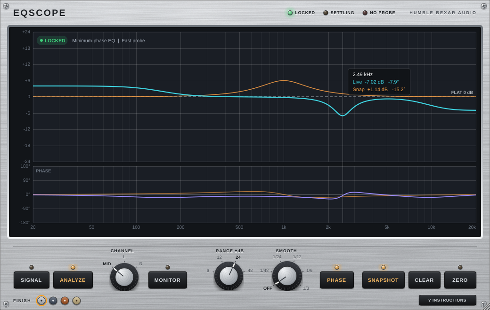
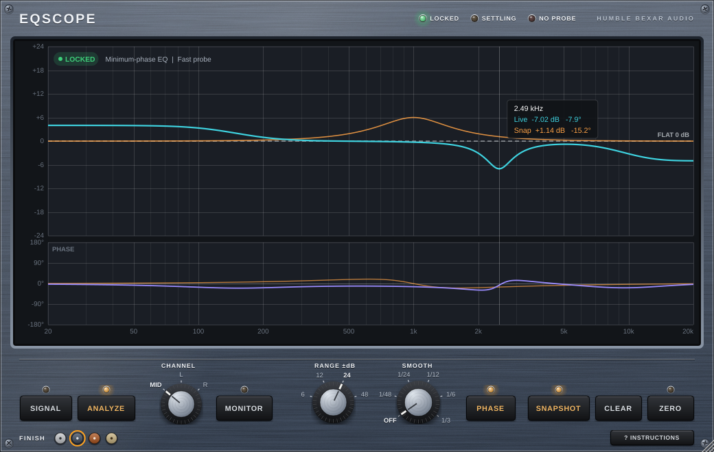
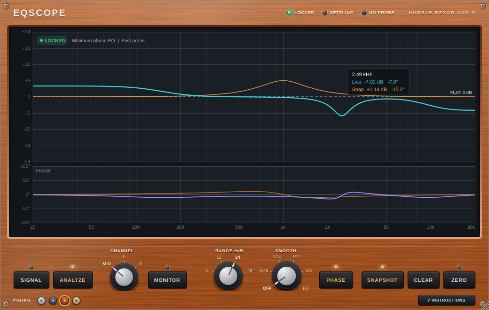
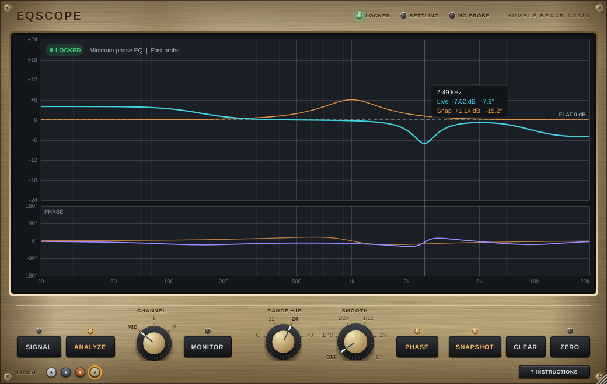

# EQScope — EQ response analyzer by Humble Bexar Audio (AU / VST3 / AUv3 for macOS, Windows and iOS)

EQScope shows exactly what another EQ plug-in does. It sends a perfectly **flat** test signal into the EQ and draws the EQ's frequency and phase response live, as you turn its knobs: the curve follows the EQ within about 0.18 seconds.

You use two copies of it on one channel, with the EQ between them:

```
[ EQScope: SIGNAL ]  →  [ any EQ plug-in ]  →  [ EQScope: ANALYZE ]
```

- **SIGNAL** replaces the audio with the probe signal. Its screen shows the flat 0 dB line it is sending.
- **ANALYZE** measures what comes out of the EQ and draws the response against that flat line. By default it outputs silence, so you don't hear the probe.



*EQScope was called **EQ Probe** before 1.0. It keeps EQ Probe's plug-in IDs, so sessions saved with EQ Probe open in EQScope with their settings, and the installers replace EQ Probe rather than adding a second copy. If you built EQ Probe yourself on a Mac, also delete `~/Library/Audio/Plug-Ins/Components/EQ Probe.component` and `~/Library/Audio/Plug-Ins/VST3/EQ Probe.vst3`, which builds copy into your user Library.*

## How it works
- **Probe signal:** a periodic multisine, every frequency bin at exactly the same level (flat to within 0.000001 dB), Schroeder phases for a 3.3 dB crest factor, at −18 dBFS RMS.
- **Measurement:** because the probe repeats exactly, any one-period window of the EQ's output has no FFT leakage. Dividing its spectrum by the known probe spectrum gives the EQ's transfer function exactly. The two copies don't communicate, and EQ latency doesn't matter.
- **Speed:** the **Fast** probe is about 170 ms long (8,192 samples at 44.1/48 kHz, 16,384 at 88.2/96, 32,768 at 176.4/192), so the whole curve has caught up about 0.18 s after a change. The editor re-analyses up to 60 times a second while the signal is changing and skips the work when nothing has changed.
- **Resolution:** a fine 32,768-point response (1.46 Hz at 48 kHz) is rebuilt from the EQ's impulse response. That's exact as long as the EQ's ringing dies away within one period, which covers typical settings (better than 0.01 dB). Very narrow, deep bands below about 60 Hz ring longer; the screen then suggests **FINE** (a 680 ms probe, exact for those too).
- **Recognising the probe:** each period is compared with the one before (LOCKED when they match). While a knob moves the periods differ but the measured impulse response stays sharp, so it reads SETTLING and keeps following. Music, noise or the other probe length look like noise and read NO PROBE; the analyzer then tries the other probe length, which is how it follows FINE automatically.
- **Phase:** the delay (window offset plus any EQ latency) is removed. For minimum-phase EQs the phase shown is the EQ's true phase; for linear-phase EQs it is relative to the impulse peak, so they read as 0°.

It measures linear behaviour: dynamic EQs and compressors show their response at the probe's level only.

## Controls
| Control | Mode | What it does |
|---|---|---|
| **SIGNAL / ANALYZE** | both | What this copy does. SIGNAL goes before the EQ; ANALYZE goes after it. The LED shows the active one. |
| **OUTPUT** (green LED) | Signal | Turns the probe on or off. |
| **FINE** | Signal | Off (default): Fast probe, the curve follows the EQ within about 0.18 s. On: Fine probe, about 0.7 s, exact even for very narrow bands below about 60 Hz. The ANALYZE copy follows automatically. |
| **CHANNEL** knob | Analyze | Measure **MID** (left and right averaged), **L** or **R**. Use L or R for EQs with different settings per side, or in mid/side mode. |
| **MONITOR** | Analyze | Off (default): this copy outputs silence. On: passes the audio through. |
| **RANGE** knob | both | Vertical scale: ±6, ±12, ±24 or ±48 dB. |
| **SMOOTH** knob | both | OFF, or 1/48 to 1/3 octave. Usually unnecessary, because the measurement isn't noisy. |
| **PHASE** | both | Shows the phase response under the frequency response. |
| **SNAPSHOT** | Analyze | Freezes the current curve as an orange overlay, to compare two settings or two EQs. The LED shows a snapshot is stored. Saved with your session. |
| **CLEAR** | Analyze | Removes the snapshot. |
| **ZERO** | Analyze | Treats the current response as flat, cancelling anything else in the chain. Press again to remove. Saved with your session. |
| **Status lights** | both | **LOCKED** (green): exact. **SETTLING** (amber): a knob is moving; the curve is dimmed slightly. **NO PROBE** (red): the audio isn't the probe. All off: nothing is arriving. |
| **FINISH** | 4 swatches, bottom left | Faceplate finish (see below). |
| **? INSTRUCTIONS** | button, bottom right | Opens the built-in instructions. |

## The panel
The window is the EQScope faceplate (1040 × 660 at its default size), a brushed-metal plate drawn live in code with **Humble Bexar Audio** at the top right. On it:
- four Phillips screws, and the **EQSCOPE** logo at the top left
- three LED status lights (LOCKED, SETTLING, NO PROBE) with chrome bezels
- a recessed black-glass screen with the response graph, the dashed **FLAT 0 dB** reference, the live curve (cyan), its phase (violet) and the snapshot (orange)
- black rotary selector knobs with knurled skirts, spun-metal caps and white pointers, their positions engraved around them
- black push buttons, each with an amber LED above it (green for OUTPUT)

If an EQ has a very narrow, deep low band that rings longer than the Fast probe, the screen says so and suggests pressing **FINE** on the SIGNAL copy.

### Faceplate finishes
Choose a finish with the **FINISH** swatches at the **bottom left of the faceplate** (same layout and behaviour as SoftSpoken). Right-clicking the faceplate or clicking the **EQSCOPE** logo gives the same choices. "Humble Bexar Audio" is on every finish:

| Finish | Look | Lettering |
|---|---|---|
| **Silver** (default) | Brushed aluminium, aluminium knob caps | Black |
| **Gunmetal Blue** | Dark blued steel | White |
| **Burnt Orange** | Brushed burnt-orange metal | White |
| **Vintage** | Aged champagne brass with darker worn edges, a light patina and brass knob caps | Dark brown |

| Silver | Gunmetal Blue |
|---|---|
|  |  |
| **Burnt Orange** | **Vintage** |
|  |  |

The finish only changes the look. It's saved with your session, and the last finish you pick becomes the default for new instances. That default is stored in `~/Library/Application Support/Humble Bexar Audio/EQScope.settings` (on Windows, `%APPDATA%\Humble Bexar Audio\EQScope.settings`).

- **Knobs:** drag up or down, scroll, or click an engraved position to jump to it. Double-click resets to the default.
- **Reading values:** hover over the graph (tap or drag on a touch screen) for frequency, gain and phase.
- **Resizing:** drag the corner on Mac and Windows (480 × 360 up to 2400 × 1400). On iPhone and iPad the host sets the size: the controls wrap onto two or three rows, and on very short screens the phase pane steps aside.
- **Changing the look:** each finish's colours are in `faceplate::palette()` in `Source/Faceplate.h`, the brushed texture in `faceplate::makeBrushedTile()`, Vintage's wear and patina in `faceplate::drawPlate()`, and the control layout in `EQScopeEditor::resized()`.

## User guide
`docs/EQScope User Guide.pdf` (built from the Frazzler guide's layout) is the guide for people using the plug-in: how it works, installing on macOS, Windows and iOS (including upgrading from EQ Probe), setting up a measurement in Logic, other DAWs and on iPad, every control, the status lights and screen, the built-in instructions, the finishes, starting points, troubleshooting, uninstalling and specifications. Both installers include it:
- **macOS:** `/Applications/Humble Bexar Audio/EQScope User Guide.pdf`
- **Windows:** `C:\Program Files\Humble Bexar Audio\EQScope\`, plus a Start menu shortcut

To change it, edit `docs/make_user_guide.py` and run `python3 docs/make_user_guide.py` (needs `pip install reportlab pillow`). Its screenshots are in `docs/images`; regenerate them with the screenshot tool (see *Tests and screenshots*).

The plug-in also has short instructions built in (**? INSTRUCTIONS** on the faceplate). The installers show setup notes too: welcome, readme and conclusion pages on macOS, and before/after pages on Windows.

## Setting up a measurement
**Logic Pro:** create an **Aux channel strip** (**Mixer → Options → Create New Auxiliary Channel Strip**); aux strips are always processing, so you don't need to press play. Insert **EQScope** (press **SIGNAL**), then your EQ, then **EQScope** again (leave it on **ANALYZE**). Open the last one: the **LOCKED** light comes on. Turn the EQ's knobs and the curve follows.

**Other DAWs:** the same three inserts on one track. Use a track that is processing (some DAWs only run plug-ins while playing, or while the track is armed or monitoring).

**iPad / iPhone:** add **EQScope → your EQ → EQScope** on one channel in your host, set the first to **SIGNAL** and open the last. In AUM, an audio channel with no input is always live. In Logic Pro for iPad and GarageBand, press play if no light comes on.

## Build (macOS)
Requirements: Xcode (with its command-line tools), CMake 3.22 or newer (`brew install cmake`), and internet access the first time, because JUCE 8.0.15 is downloaded automatically.

```bash
cd EQScope
cmake -B build -G Xcode
cmake --build build --config Release
```

The build copies the plug-in here automatically:
- `~/Library/Audio/Plug-Ins/Components/EQScope.component` (AU, used by Logic)
- `~/Library/Audio/Plug-Ins/VST3/EQScope.vst3` (Ableton, Cubase, Reaper, Studio One, FL Studio, Bitwig…)
- The standalone app is in `build/EQScope_artefacts/Release/Standalone/`

The binary is universal (Apple Silicon and Intel) and runs on **macOS 12.7 Monterey or later**.

**Windows:** the same CMake project builds a VST3 and a standalone app with Visual Studio 2022 or newer (**Desktop development with C++**): `cmake -B build -A x64` then `cmake --build build --config Release`. AU is skipped automatically. The plug-in uses the static Visual C++ runtime, so it runs on PCs without the redistributable. Copying into `C:\Program Files\Common Files\VST3` needs admin rights, so the build doesn't do it on Windows: use the installer, copy `build\EQScope_artefacts\Release\VST3\EQScope.vst3` there yourself, or configure from an administrator terminal with `-DEQSCOPE_COPY_AFTER_BUILD=ON`. To pick formats yourself, pass `-DEQSCOPE_FORMATS="VST3;Standalone"`.

### Validate and load in Logic
```bash
auval -v aufx Eqpb Hmbx
```
1. Restart Logic. If it doesn't show up, go to **Logic Pro → Settings → Plug-in Manager**, select it and click **Reset & Rescan Selection**.
2. On any channel strip, open **Audio FX → Audio Units → Humble Bexar Audio → EQScope**.

## Building for iPhone and iPad (AUv3)
Requirements: a Mac with Xcode, and an Apple account signed in to Xcode (**Xcode › Settings › Accounts**). A free account works for your own devices; TestFlight and the App Store need a paid Apple Developer Program membership. It runs on **iOS / iPadOS 13 or later**.

```bash
cd EQScope
cmake -B build-ios -G Xcode -DCMAKE_SYSTEM_NAME=iOS
open build-ios/EQScope.xcodeproj
```

1. In Xcode, select the **EQScope_Standalone** target, then under **Signing & Capabilities** choose your team. Do the same for **EQScope_AUv3**. If Xcode says the bundle ID is taken, add a suffix to `BUNDLE_ID` in `CMakeLists.txt` and run the cmake command again.
2. Plug in your iPhone or iPad, pick it as the run destination, choose the **EQScope_Standalone** scheme and press **Run**.
3. Open EQScope once on the device. Then add it as an effect in Logic Pro for iPad, GarageBand, AUM, Cubasis or any AUv3 host (**Audio Units › Humble Bexar Audio › EQScope**).

Or from the command line: `TEAM_ID=ABCDE12345 ./installer/ios/build_ios.sh` makes a development `.ipa` for your devices in `dist/ios`. Add `METHOD=app-store` to make one for TestFlight or the App Store.

Apps installed with a free account expire after 7 days. For longer, or to share with others, archive it (**Product › Archive**) and upload to TestFlight or the App Store with a paid account. iOS has no installer files like the Mac and Windows ones; apps reach other people only through TestFlight or the App Store. The app asks for microphone access only if you use the app itself in ANALYZE mode; the AUv3 doesn't need it.

The GitHub build compiles the iOS version too (unsigned) to check that it builds.

## Starting points
- **Learn what a knob really does:** sweep one band's frequency, gain and Q and watch the curve.
- **Match two EQs:** dial in EQ A, press **SNAPSHOT**, swap in EQ B and adjust it until the cyan curve sits on the orange one.
- **Check a linear-phase EQ:** turn **PHASE** on. A true linear-phase EQ shows a flat 0° line and "Linear/mixed-phase EQ".
- **Measure only your changes:** with the EQ where you started, press **ZERO**. From then on the curve shows only what you change.
- **Stereo or M/S EQs:** set **CHANNEL** to L, then R, and use **SNAPSHOT** to compare the sides.
- **Deep low-end work:** for narrow bands below about 60 Hz (for example +12 dB at 30 Hz with a Q of 4), press **FINE** on the SIGNAL copy.
- **Analog-modelled EQs:** the probe plays at −18 dBFS RMS, the level they're designed for. Their saturation adds a little blur to the curve.

## Tests and screenshots
The DSP core (`Source/EQScopeDSP.h`) is plain C++ and has its own tests: that both probe lengths are flat at every sample rate; that measured magnitude and phase match the exact maths for bells, shelves, a high-pass, a 4-band EQ, a linear-phase FIR with 255 samples of latency and an EQ adding −90 dBFS hiss, with both the Fast and Fine probes; that very narrow low bands raise the "use FINE" message with Fast and measure exactly with Fine; that a big EQ jump reads as SETTLING, never NO PROBE; and that the Fast analyzer rejects the Fine probe, noise and silence.

```bash
cmake -B build-tests -DEQSCOPE_TESTS_ONLY=ON
cmake --build build-tests
./build-tests/eqscope_tests
```

The faceplate screenshots in `docs/images` come from the real editor code: configure with `-DEQSCOPE_SNAPSHOT=ON`, build the `eqscope_snapshot` target and run it with `docs/images` as its argument. It plays the probe through a simulated 3-band EQ into a SIGNAL and an ANALYZE instance, keeps a snapshot of a +6 dB bell, then renders each finish, the SIGNAL view, the instructions and an iPhone-sized view. On a headless Linux machine, run it under `xvfb-run`.

## Making installers
**macOS:** after a Release build and `python3 docs/make_user_guide.py`, run `./installer/macos/make_installer.sh`. It creates `dist/EQScope-1.0.0-macOS.pkg`, which installs the AU and VST3 for all users, plus the standalone app and the user guide in `/Applications/Humble Bexar Audio`. **Customize** in the installer lets people pick which of the three to install. It requires macOS 12.7 or later, shows welcome, readme and conclusion pages, and removes EQ Probe if it's installed.

- **Unsigned** (free): works, but macOS blocks it the first time. The other person has to Control-click it and choose Open, or go to **System Settings → Privacy & Security** and click **Open Anyway**.
- **Signed and notarized** (needs a paid Apple Developer account): opens with no warnings. Create "Developer ID Application" and "Developer ID Installer" certificates, run `xcrun notarytool store-credentials eqscope-notary` once, then set `APP_CERT`, `INST_CERT` and `NOTARY_PROFILE` (see the top of the script) before running it.

**Windows:** after a Release build and making the guide, run `iscc installer\windows\EQScope.iss` ([Inno Setup](https://jrsoftware.org/isinfo.php) 6.3 or newer). It creates `dist\EQScope-1.0.0-Windows-Setup.exe`, which installs the VST3, the standalone app, the user guide and Start menu shortcuts, shows before/after pages, and adds an uninstaller. It upgrades an existing EQ Probe install in place.

## Building installers on GitHub (no Mac or PC needed)
Push this folder to a GitHub repository. The workflow in `.github/workflows/build.yml` runs on every push. It runs the DSP tests, publishes the user guide, then builds:
- **EQScope-1.0.0-macOS.pkg** for macOS (AU + VST3 + app, universal, checked with `auval`), on GitHub's Mac machines
- **EQScope-1.0.0-Windows-Setup.exe** for Windows (VST3 + standalone, made with Inno Setup from `installer/windows/EQScope.iss`)
- the iOS AUv3 and app, unsigned, to check that it compiles

Both installers include the user guide.

When the run finishes, download them from the run's **Artifacts** section on the **Actions** tab. To run it by hand, open **Actions → Build installers → Run workflow**.

The Mac installer is unsigned unless you add your Apple Developer ID certificates and notarization login as repository secrets. The top of the workflow lists the secret names. The Windows installer is unsigned, so Windows SmartScreen will warn the first time: click **More info → Run anyway**.

## Customizing
The company is **Humble Bexar Audio** (manufacturer code `Hmbx`) and the plug-in code is `Eqpb`, with the bundle ID `com.humblebexar.eqprobe`; all are set in `CMakeLists.txt`. They are kept from EQ Probe (EQScope's name before 1.0) so its sessions and installs carry over. Keep these codes the same in every future version, or hosts treat it as a different plug-in and old sessions lose their settings. To distribute to other Macs without warnings, sign and notarize it (see above).

Measurement settings live in `Source/EQScopeDSP.h`:
- `orderForSampleRate()`: Fast and Fine probe lengths (how quickly the curve follows a change vs. how long an EQ may ring)
- `kSignalRmsDb`: probe level
- `kFineOrder`: size of the rebuilt response grid
- `kTailLimitDb`: how much leftover ringing triggers the "use FINE" message
- `kMinCrestDb`: how sharp the impulse response must be to count as the probe while a knob moves

## Source layout
| File | Purpose |
|---|---|
| `Source/EQScopeDSP.h` | Probe signals, transfer-function analyzer, delay/phase handling, ringing check, display resampling (no JUCE dependency) |
| `Source/PluginProcessor.*` | Parameters, probe generator, capture ring buffer, finish, zero/snapshot save and restore, loading EQ Probe sessions |
| `Source/PluginEditor.*` | The faceplate layout, status lights, finish menu, control wiring, analysis loop, and the response screen |
| `Source/Faceplate.h` | The four finishes and the drawing of the plate, screws, LEDs, push buttons, selector knobs and FINISH swatches |
| `Source/Instructions.h` | The built-in instructions |
| `tools/snapshot.cpp` | Renders the faceplate screenshots |
| `docs/make_user_guide.py` | Builds `docs/EQScope User Guide.pdf` |
| `docs/images/` | Faceplate screenshots used by the guide and this README |
| `installer/macos/` | `make_installer.sh`, `distribution.xml` and the installer's pages |
| `installer/windows/` | Inno Setup script and the installer's pages |
| `installer/ios/` | `build_ios.sh` and `ExportOptions.plist` |
| `tests/core_test.cpp` | DSP tests |

## A note on naming
EQ and transfer-function analyzers exist from several companies (for example DDMF Plugin Doctor and Rational Acoustics Smaart). EQScope is an independent design. It doesn't use their names, artwork or code, and it isn't affiliated with any of them. Keep it that way if you release it publicly.
